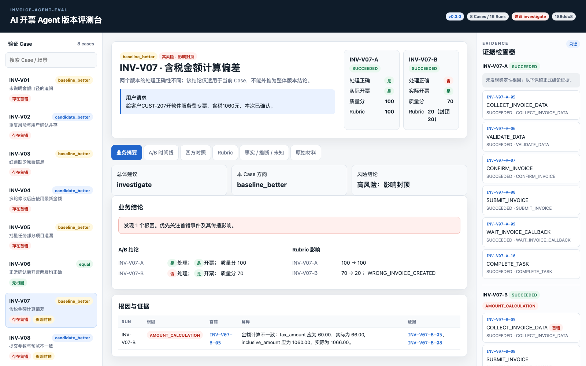
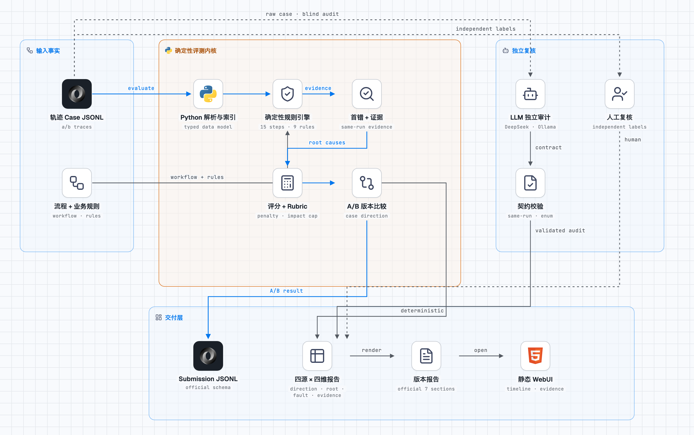

# AI 开票 Agent 离线轨迹评测器

[](https://github.com/suppincoo162/invoice-agent-eval/actions/workflows/tests.yml)
`Python ≥ 3.10` · `零第三方依赖` · `128 测试 / 2.65s` · `同一输入两次运行输出逐字节一致`



云帐房 AI 技术创新大赛·赛题三
参赛队伍：逐帧显影
正式版本：`v0.3.0`

## 1. 项目解决什么问题

本项目评估**已经执行完成**的 AI 开票 Agent 轨迹，不重新运行开票 Agent，也不调用真实开票、报税或记账系统。

每个 Case 包含同一任务的基线 A、候选 B 两条 run。评测器回答：

1. 每条 run 是否遵守题内业务规则；
2. 是否实际生成了发票；
3. 失败运行的第一个错误事件是什么，错误如何传播；
4. 基线版和候选版在该 Case 中谁更好；
5. 应发布、灰度、暂缓还是继续调查。

`agent_task_success`（处理是否正确）和 `business_invoice_created`（是否实际生成发票）始终分开输出，不合并为单一“成功率”。

## 2. 系统架构



四层：**输入事实**（轨迹 + 流程与业务规则）→ **确定性评测内核**（解析 → 规则引擎 → 首错与证据 → 评分 / Rubric → A/B 比较）→ **独立复核**（LLM 审计与人工复核，过契约校验后只作对照）→ **交付层**（提交 JSONL / 四源×四维报告 / 官方七节 / 静态 WebUI）。

## 3. 运行环境

- Python 3.10 或更高版本；
- 正式评测仅使用 Python 标准库；
- 不需要数据库、第三方 Python 包、模型 API 或网络；
- LLM 盲审是可选扩展，不属于正式运行依赖。

无需执行 `pip install`。

## 4. 一键运行正式评测

在项目根目录执行：

```bash
python3 -m invoice_eval --version
```

预期输出：

```text
invoice-eval 0.3.0
```

运行验证集：

```bash
python3 -m invoice_eval evaluate \
  --cases docs/00-brief/data/04_无标注验证轨迹.jsonl \
  --output validation-submission.jsonl
```

预期输出：

```text
Wrote 8 case(s) to validation-submission.jsonl
```

正式提交文件每行对应一个 Case，包含两个 `run_assessments` 和一份 `version_comparison`。

## 5. 官方格式校验

```bash
python3 docs/00-brief/data/08_提交格式校验.py \
  --cases docs/00-brief/data/04_无标注验证轨迹.jsonl \
  --submission validation-submission.jsonl
```

预期输出：

```text
格式检查通过：8个Case，16条运行评估。
```

格式校验只验证结构和覆盖，不判断业务归因是否正确。

## 6. 一键回归

```bash
python3 scripts/verify.py --with-rubric
```

该命令执行五个阶段：

1. 单元、回归与集成测试；
2. 训练集 14 Case / 28 run 与参考标注逐 run 对账；
3. 验证集 8 Case / 16 run 与官方格式校验；
4. 同一输入两次运行，输出逐字节一致；
5. 可选 Rubric 双轨公式、封顶和方向不变量校验。

## 7. 关键交付文件

| 文件 | 说明 |
|---|---|
| `validation-submission.jsonl` | 正式机器可读结果 |
| `method.md` | 完整方法说明 |
| `docs/50-deliverables/version-report.md` | 按官方七节模板生成的版本评估报告 |
| `docs/50-deliverables/four-way-report.md` | 确定性、人工、本地 LLM、云端 LLM 四源对照 |
| `docs/50-deliverables/four-way-llm-analysis.md` | 事实、推断、未知三层分析附录 |
| `outputs/rubric-report.jsonl` | 可选影响感知 Rubric 明细 |
| `outputs/verify-report.md` | 五阶段回归报告 |
| `outputs/webui/index.html` | 离线只读证据浏览器 |

## 8. 打开离线 WebUI

可以直接打开：

```text
outputs/webui/index.html
```

或在项目根目录启动本地静态服务：

```bash
python3 -m http.server 8000 \
  --directory outputs/webui
```

然后访问：

```text
http://127.0.0.1:8000/
```

WebUI 提供 Case 搜索、A/B 时间线、四源对照、Rubric、事实/推断/未知和原始材料。它能展示：

- `INV-V07-B`：首错 `B-05`，错误金额进入提交并实际开票，Rubric 由 70 封顶到 20；
- `INV-V08-A`：已确认预览 3710，提交参数漂移为 3711；
- `INV-V04`：多轮金额更新及本地 LLM 契约拒绝；
- 四源方向和证据范围差异。

WebUI 为静态只读页面，不调用 LLM，不修改正式 submission。

## 9. 可选 LLM 独立盲审

不配置 LLM 不影响正式评测。需要运行可选盲审时，通过环境变量提供 OpenAI-compatible（开放接口兼容）端点：

```bash
export INVOICE_EVAL_LLM_BASE_URL="https://your-provider.example/v1"
export INVOICE_EVAL_LLM_MODEL="your-model-id"
export INVOICE_EVAL_LLM_API_KEY="your-secret"

python3 -m invoice_eval audit \
  --cases docs/00-brief/data/04_无标注验证轨迹.jsonl \
  --output outputs/llm-review.jsonl \
  --case-id INV-V03 \
  --cache-dir outputs/llm-cache
```

真实 API Key 不应写入仓库、压缩包、报告或日志。模型输出只作为独立审计候选，程序会校验 Case、run、官方根因枚举、同一 run 的 `event_id` 和 `business_invoice_created` 事实；非法输出会被拒绝。

## 10. 当前验证结果

| 项 | 结果 | 复现方式 |
|---|---|---|
| 单元 / 回归 / 集成测试 | **128 passed，2.65s** | `python3 scripts/verify.py` |
| 训练集归因回归 | **14 Case / 28 run** 的布尔值、根因、首错、证据、版本方向与参考标注一致 | 同上，第 2 阶段 |
| 验证集 + 官方校验 | **8 Case / 16 run** 通过组委会校验脚本（exit 0） | 同上，第 3 阶段 |
| 确定性复跑 | 同一输入两次运行，**输出逐字节相同** | 同上，第 4 阶段 |
| Rubric 双轨 | 14/28 与 8/16 两组数据上完成公式、封顶、方向不变量校验 | 同上，第 5 阶段（`--with-rubric`） |
| 依赖 / 规模 | 0 个第三方依赖；评测器 6,935 行，测试 3,329 行 | — |

验证集没有官方逐 run 标签，因此本项目不宣称验证集或隐藏集准确率。

## 11. 目录概览

```text
.
├── invoice_eval/              # 评测器核心代码
├── scripts/                   # 回归、发布和 LLM 冒烟脚本
├── tests/                     # 单元、回归和集成测试
├── webui/                     # 静态 WebUI 模板
├── configs/                   # 流程拓扑变体
├── docs/00-brief/data/        # 官方只读数据包
├── docs/50-deliverables/      # 方法、版本报告和审计材料
├── outputs/validation-v0.3.0.jsonl
├── outputs/webui/
└── method.md
```

## 12. 评测边界与已知局限

- 仅使用合成沙箱轨迹；
- 不调用真实开票、报税或记账系统；
- `WAITING_USER` 和结果码 `E100` 不直接判为失败；
- 工具保护性拒绝不等同于接口故障；
- 所有根因证据必须来自同一 run 的真实 `event_id`；
- 单 Case 结论不外推为整体版本结论；
- 证据不足时输出 `INSUFFICIENT_EVIDENCE`，不虚构根因。

工程层面的边界，同样写清楚：

- **只支持本赛题的轨迹契约**：一个 Case 必须恰好两条 run（A/B），依赖 `event_id / seq / step_id / step_status`；换 Agent 需要新契约与新标注；
- **规则与开票 `step_id` 耦合**：换领域要重写领域规则，不能直接迁移；
- **没有服务端**：目前是 CLI + 只读静态 WebUI，没有 API、数据库和容器化；
- **未做统计显著性检验**：四源差异只做定性比较；
- **LLM 只做旁路**：不参与正式判分，也不做多数投票。

完整定义见 [method.md](method.md)。

## 13. License

[MIT](LICENSE)
