# 开票 Agent 流程图

> 事实源：[`01_竞赛版流程字典.json`](data/01_竞赛版流程字典.json)。本图是流程字典的可视化，不新增或删除任何合法转移；两者冲突时以流程字典为准。

```mermaid
flowchart TD
  START((开始)) --> RECEIVE_REQUEST

  RECEIVE_REQUEST["1. 接收开票请求"]
  CREATE_TASK["2. 创建开票任务"]
  RESOLVE_ENTERPRISE["3. 识别销方企业"]
  PARSE_INTENT["4. 解析用户开票意图"]
  COLLECT_INVOICE_DATA["5. 采集发票信息"]
  WAIT_USER_SUPPLEMENT["6. 等待用户补充信息"]
  VALIDATE_DATA["7. 校验开票数据"]
  CONFIRM_INVOICE["8. 确认开票内容"]
  SUBMIT_INVOICE["9. 提交开票"]
  WAIT_INVOICE_CALLBACK["10. 等待开票结果回调"]
  COMPLETE_TASK["11. 完成任务并返回结果"]
  FAIL_TASK["12. 记录失败并返回原因"]
  TIMEOUT_TASK["13. 任务超时"]
  TRANSFER_TO_HUMAN["14. 转人工处理"]
  CANCEL_TASK["15. 取消任务"]

  RECEIVE_REQUEST --> CREATE_TASK
  CREATE_TASK --> RESOLVE_ENTERPRISE
  RESOLVE_ENTERPRISE --> PARSE_INTENT

  PARSE_INTENT --> CANCEL_TASK
  PARSE_INTENT --> COLLECT_INVOICE_DATA

  COLLECT_INVOICE_DATA --> VALIDATE_DATA
  COLLECT_INVOICE_DATA --> WAIT_USER_SUPPLEMENT
  COLLECT_INVOICE_DATA --> TIMEOUT_TASK

  WAIT_USER_SUPPLEMENT --> VALIDATE_DATA
  WAIT_USER_SUPPLEMENT --> CANCEL_TASK
  WAIT_USER_SUPPLEMENT --> TIMEOUT_TASK

  VALIDATE_DATA --> CONFIRM_INVOICE
  VALIDATE_DATA --> WAIT_USER_SUPPLEMENT
  VALIDATE_DATA --> TRANSFER_TO_HUMAN

  CONFIRM_INVOICE --> SUBMIT_INVOICE
  CONFIRM_INVOICE --> COLLECT_INVOICE_DATA
  CONFIRM_INVOICE --> CANCEL_TASK
  CONFIRM_INVOICE --> TIMEOUT_TASK

  SUBMIT_INVOICE --> WAIT_INVOICE_CALLBACK
  SUBMIT_INVOICE --> TRANSFER_TO_HUMAN
  SUBMIT_INVOICE --> FAIL_TASK

  WAIT_INVOICE_CALLBACK --> COMPLETE_TASK
  WAIT_INVOICE_CALLBACK --> FAIL_TASK
  WAIT_INVOICE_CALLBACK --> TIMEOUT_TASK

  classDef waiting fill:#fff4cc,stroke:#c28b00,stroke-width:2px
  classDef terminal fill:#e8f1ff,stroke:#3273dc,stroke-width:2px

  class WAIT_USER_SUPPLEMENT,WAIT_INVOICE_CALLBACK waiting
  class COMPLETE_TASK,FAIL_TASK,TIMEOUT_TASK,TRANSFER_TO_HUMAN,CANCEL_TASK terminal
```

## 读图约定

- 中间节点是流程字典中的 15 个 `step_id`。
- 箭头只表示 `possible_next_steps` 中的合法转移。
- 黄色节点是等待态；等待本身不等于失败。
- 蓝色节点是终态。
- `START` 只是阅读辅助，不属于流程字典中的 15 个步骤。
