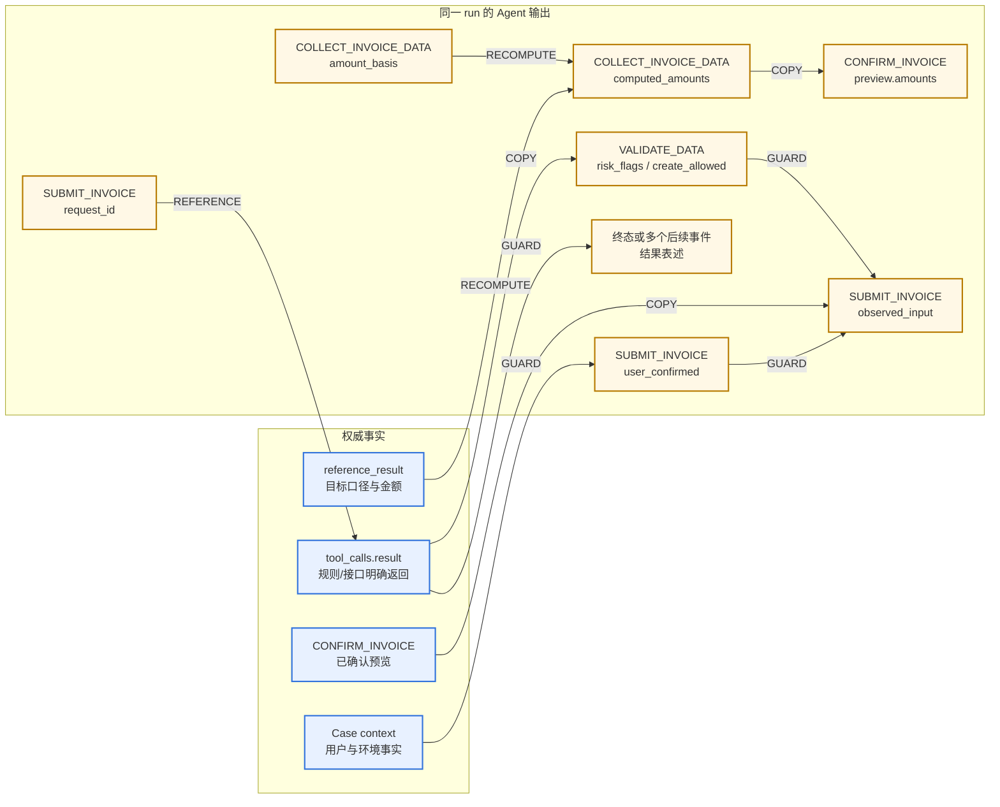

# 反事实最小修复：依赖图与修复边界（候选）

> 状态：**候选设计，未进入 MVP**。用于检验首因、传播链和责任对象，不改写真实轨迹、不模拟 Agent 重跑，也不直接改变提交结果。进入实现的前置门槛见 [`decisions.md`](decisions.md) ADR-004。

> Rubric 接入方式见 [`evidence-impact-rubric.md`](evidence-impact-rubric.md)：消失的 finding 属于传播，残留 finding 才进入独立根因和对应评分维度。

## 一、依赖图

依赖图使用四类边：

- `RECOMPUTE`：由业务规则重新计算目标字段。
- `COPY`：下游字段应复制上游字段。
- `GUARD`：下游动作依赖前置条件，但**不通过修复模拟新的业务分支**。
- `REFERENCE`：通过业务标识串联两个事件。



图中的边表达“字段可以沿哪条规则向下游传播”，不等于字段值相等就自动存在依赖。依赖必须由预先声明的规则产生。

## 二、节点表示

内部字段节点使用实际事件锚点：

```text
FactKey(
  run_id="INV-T01-B",
  event_id="INV-T01-B-05",
  path="observed_output.amount_basis"
)
```

- 节点必须指向同一 run 的真实事件和字段。
- 修复后重算的值仍挂在原事件节点上，不能创建虚构 `event_id`。
- 跨 run 相减、复制或替换一律禁止。
- 原始轨迹在修复前后都不可变；修复只发生在单独的反事实视图。

## 三、边与修复策略

| 依赖 | 类型 | 权威来源 | 可修复 | 传播范围 |
|---|---|---|---|---|
| 金额口径 → 金额三元组 | `RECOMPUTE` | `reference_result.amount_basis`、商品 `configured_rate` | 是 | 只重算该事件的金额 |
| 采集金额 → 预览金额 | `COPY` | 同一 run 中已修复的采集金额 | 是 | 预览金额 |
| 已确认预览 → 提交参数 | `COPY` | `CONFIRM_INVOICE.preview` | 是 | 提交参数 |
| `tool_calls.result` → `observed_output` | `COPY` | 同一 run 的明确工具结果 | 仅结构化字段 | 当前事件及后续采用该字段的判断 |
| 风险结果 → 是否提交 | `GUARD` | 工具返回和业务规则 | 否 | 只解释依赖，不生成新分支 |
| 用户确认 → 是否允许提交 | `GUARD` | `context`、确认事件、提交参数 | 否 | 只解释依赖，不伪造用户确认 |
| `request_id` → 回调 | `REFERENCE` | 提交工具返回 | 否 | 只建立请求链路 |
| 回调结果 → 最终表述 | `GUARD` | 回调工具结果 | 否 | 只判断表述是否忠实，不模拟外部结果 |

## 四、可修复范围

### 第一档：可完整重算

- 含税/不含税金额口径；
- 税额、税前金额、含税金额；
- 预览到提交之间的金额复制。

这些字段有明确公式或直接复制关系，适合做拓扑重算。

### 第二档：可结构化替换

- 批量 `line_items`；
- 唯一且明确的原票编号；
- `context` 中唯一确定的购方或商品；
- 已确认预览中的结构化提交参数。

如果存在多个候选、来源冲突或缺少权威值，必须停止修复。

### 第三档：只解释依赖，不模拟分支

- 用户确认；
- 重复风险阻断；
- 取消后是否继续；
- 接口状态未知时是否重试；
- 失败回调如何解释；
- 开票、红票、取消等意图分类。

这些前置条件可以解释“后续动作依赖什么”，但修复字段后 Agent 会进入哪条流程是未观测事实，不能假装重新运行。

## 五、修复执行规则

1. 从一个已通过确定性规则验证的 finding 开始。
2. 解析它的 `first_fault_event_id` 和具体字段路径。
3. 查找预先声明的修复来源和转换规则。
4. 复制当前反事实视图，只替换目标字段。
5. 按 `seq` 和声明依赖进行拓扑重算，禁止反向修改早期事件。
6. 不创建事件，不改变真实 `final_state`、`invoice_created` 或工具返回。
7. 重新运行原检查器，对比修复前后的 findings。
8. 每个根因单独修复；需要时再做一次联合修复，联合结果只表示整体传播范围。

如果依赖图存在环、修复来源缺失、值类型不匹配或来源冲突，则状态为 `insufficient_evidence`，不做推断。

## 六、修复结果

对每个 finding 输出以下内部结构：

```text
RepairResult(
  finding_id,
  label,
  actor,
  first_fault_event_id,
  repair_target,
  repair_source,
  repair_kind,
  status,
  removed_finding_ids,
  surviving_finding_ids,
  new_finding_ids,
  propagated_event_ids
)
```

状态取值：

- `supported`：修复来源和重算路径完整，且结果可复核。
- `not_repairable`：依赖属于 `GUARD`，只可解释，不可模拟分支。
- `insufficient_evidence`：缺少来源、冲突或无法唯一重算。

解释规则：

- 修复后消失的 finding：传播结果。
- 修复后仍存在的 finding：独立根因候选，仍需原规则确认。
- 修复后新出现的 finding：反事实副作用，不得写回真实根因。
- 修复范围外仍无法判断的问题：`out_of_scope` 或 `insufficient_evidence`。

## 七、责任分配

| 责任对象 | 判定依据 | 对 Agent 的扣分 |
|---|---|---:|
| `AGENT` | Agent 写入的值、决策或动作直接违反规则 | 按对应根因扣分 |
| `TOOL` | 工具返回风险、拒绝请求或提供权威结果 | 不扣 |
| `USER` | 用户输入、修改或缺失信息 | 不扣；Agent 未正确处理时转归 Agent |
| `EXTERNAL` | 外部服务失败或明确回调 | 不扣；Agent 误报时转归 Agent |
| `UNKNOWN` | 缺少上述边界所需证据 | 不扣，标记不可评分 |

最小修复不能创造正向分数，只能说明正确保护行为不计负分。官方提交 schema 不增加 actor 或 repair 字段。

## 八、示例

### `INV-T01-B`

```text
修复 B-05.amount_basis
  → 重算 B-05.computed_amounts
  → 替换 B-07.preview.amounts
  → 替换 B-08.observed_input.amounts

AMOUNT_BASIS 消失
CONFIRMATION_BYPASS 仍存在
```

结论：金额错误和确认绕过是独立根因；工具拒绝是保护行为。实际 `invoice_created=false` 不变。

### `INV-T05-B`

工具结果包含 `DUPLICATE_INVOICE`，Agent 输出为空。可以修复结构化风险字段并说明风险被抹去；但不能假设修复后 Agent 一定进入 `FAIL_TASK` 或 `WAIT_USER_SUPPLEMENT`。工具阻断获得正向保护信用，Agent 抹去风险仍归责 Agent。

### `INV-T10-B`

没有可直接替换的错误数据字段：回调明确为失败，错误发生在 Agent 对结果的理解和最终表述。因此最小修复状态为 `not_repairable`，根因仍由确定性语义规则判定。

### `INV-T14-B`

提交参数相对已确认预览发生漂移，可以用预览值执行 `COPY` 修复。但修复只解释参数错误，不能把真实已经生成发票的 `invoice_created=true` 改成 `false`。

## 九、试点验收

在进入实现前，必须同时满足：

- 普通时序归因已在训练集回归中暴露至少两次“首因/传播难区分”的实际问题；
- 反事实修复只在内部视图运行，不改变官方输出 schema；
- 对 `INV-T01`、`INV-T05`、`INV-T10`、`INV-T14` 比较普通依赖追踪与最小修复结果；
- 新方法不能减少已正确的根因、不能跨 run 引用证据、不能改变真实业务结果；
- 无法修复时必须明确降级，不得让 LLM 补造反事实。

## 十、与现有方案的关系

- 首因与传播规则仍以 [`10-spec/spec.md`](../10-spec/spec.md) 为准。
- 评分仍由 Agent 责任根因和固定扣分账本决定。
- 本设计只增加内部因果证据，不新增评分维度。
- 当前状态仍是候选，不进入 B1/B2 MVP。
